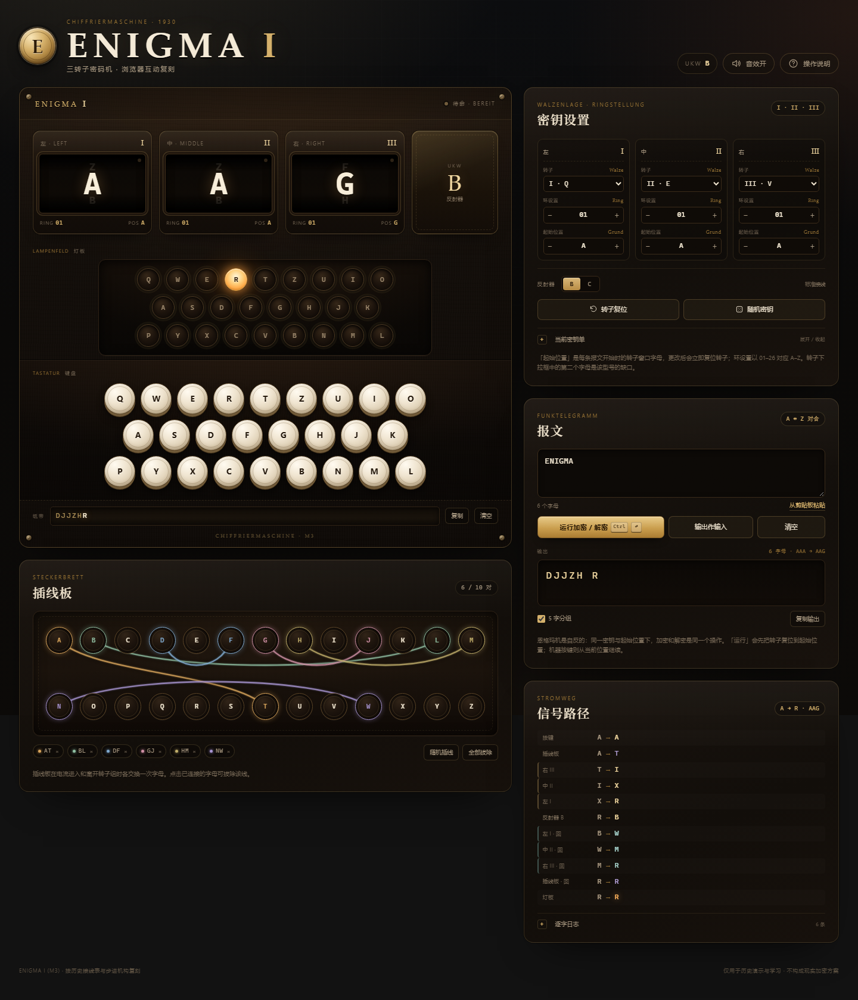

# ENIGMA I · 恩格玛机互动复刻

An interactive, historically accurate **Enigma I (M3)** simulator in vanilla HTML, CSS and JavaScript — rotors, plugboard, double stepping and a live signal path. No build step, no dependencies, works offline.

一台按历史接线表实现的 **Enigma I（M3）** 三转子密码机。纯静态网页，离线可用，不依赖任何框架或网络资源。

> **在线演示**：部署到 GitHub Pages 后，地址为 `https://<你的用户名>.github.io/<仓库名>/`。部署步骤见 [PUBLISHING.md](PUBLISHING.md)。



## 打开方式

- **直接双击 `index.html`**。所有资源都是同目录下的本地文件，不需要服务器。
- 或打开 **`enigma-standalone.html`**：CSS 和 JavaScript 全部内联在一个文件里，方便发给别人或单独存档。
- 推荐使用较新的 Chrome / Edge / Firefox / Safari。音效遵循浏览器自动播放策略，会在第一次点击后启用。
- 不需要安装依赖，也不需要构建。

## 包含的功能

### 1. 历史准确的电气模型

- 五只可更换转子 **I–V**，使用历史接线与缺口位置（I=Q、II=E、III=V、IV=J、V=Z）。
- 三只转子按左、中、右排列，同一型号不能重复使用（与实机一致）。
- **环设置 Ringstellung**（01–26，对应 A–Z）与**起始位置 Grundstellung**（A–Z）分离。
- 反射器 **UKW-B / UKW-C**。
- **插线板**最多 10 对线，电流进入和折返时各交换一次。
- 每次按键先步进、再加密；完整实现**双步进**（middle rotor 在缺口时带动左转子）。

### 2. 可操作的机器

- 26 个可按压的象牙键，使用恩格玛机真实的键盘排列：`QWERTZUIO / ASDFGHJK / PYXCVBNML`。
- 26 盏灯板灯，按下按键后点亮输出字母。
- 转子窗口显示当前字母、上下相邻字母、环设置、位置与缺口指示灯；步进时有滚动动画。
- 支持鼠标/触屏点击，也支持电脑键盘直接输入 A–Z。
- 纸带记录实时输出，可复制、清空。

### 3. 插线板可视化

- 点击两个字母建立连线，再次点击已连接的字母可拔除。
- 连线用彩色 SVG 曲线绘制；每对线有独立颜色，并在下方的配对标签中列出。
- 支持随机插满 10 对、一键全部拔除；窄屏会自动改为 7 列布局并显示配对字母。

### 4. 报文工具

- 粘贴明文或密文，点击「运行加密 / 解密」。
- 逐字动画演示转子步进；较长报文自动切换为快速模式。
- 输出可按 5 字分组显示，可一键复制。
- 「输出作输入」把当前结果放回输入框并把转子复位到起始位置，方便验证对合性。
- 逐字日志记录输入、输出与转子位置，便于观察双步进。

### 5. 信号路径

- 每次按键后显示完整路径：按键 → 插线板 → 右/中/左转子 → 反射器 → 左/中/右转子 → 插线板 → 灯板。
- 金色表示去程，青色表示回程，紫色表示插线板；每个阶段都显示字母变换。
- 右侧面板会显示这次按键的起始字母、输出字母和当前转子位置。

### 6. 密钥工作流

- **随机密钥**：随机转子顺序、反射器、环设置、起始位置和 10 对插线。
- **密钥单**：按 `Walzenlage / Ringstellung / Grundstellung / Steckerbrett / UKW` 格式展示，可复制。
- **分享链接**：把当前密钥压缩进 URL hash（`r/u/g/p/s`），复制后别人打开即可复原。
- 自动保存到 localStorage；刷新后保留密钥和偏好。分享链接载入后会清理 hash，避免之后修改被旧链接覆盖。
- **已知向量自检**：I·II·III / UKW-B / 全部 A / 无插线时，`AAAAA → BDZGO`，可在操作说明中一键运行。

### 7. 体验与可访问性

- 深色胡桃木、黄铜与暖灯光的博物馆式界面；响应式布局，320px 宽度可用。
- 声音开关（WebAudio 合成，无音频文件）；支持 `prefers-reduced-motion`。
- 键盘焦点样式、对话框焦点管理、`aria-label`、屏幕阅读器状态播报。
- 操作说明内置快速开始、双步进解释、快捷键和准确度说明。

## 快捷键

| 按键 | 作用 |
| --- | --- |
| `A`–`Z` | 逐字加密（焦点不在输入框时） |
| `Ctrl` / `Cmd` + `Enter` | 运行整段报文 |
| `Esc` | 关闭说明，或取消选中的插线 |

## 实现路径

```text
enigma/
├─ index.html              页面结构与文案
├─ styles.css              全部视觉样式与响应式布局
├─ enigma-core.js          纯 Enigma I 电气模型（UMD，可在 Node 中测试）
├─ app.js                  界面、状态、插线板、音效、存储、分享
├─ favicon.svg             站点图标
├─ build-standalone.mjs    生成单文件版本
├─ enigma-standalone.html  构建产物（CSS/JS/图标内联）
├─ package.json            测试与构建脚本（无依赖）
├─ LICENSE                 MIT
├─ PUBLISHING.md            GitHub / Pages 发布清单
├─ .gitignore / .gitattributes / .nojekyll
├─ .github/workflows/      GitHub Actions 测试
├─ preview/                桌面、移动端和社交预览图
└─ test/
   ├─ engine.test.js       17 个模型/步进/接线/插线板测试
   └─ fixtures.json        由独立 Python 参考实现生成的随机密文夹具
```

### 技术选择

- **纯原生 HTML / CSS / JavaScript**，没有 React、没有打包器、没有 CDN。这样双击 `file://` 就能运行，也方便长期存档。
- `enigma-core.js` 与界面完全解耦：输入配置和字母，返回密文、每级变换与步进结果；因此可以独立验证，不会出现“界面算对了但模型没测”的情况。
- 页面元素（26 键、26 灯、26 个插孔、转子控制）由 JS 按固定布局生成，减少重复 HTML，并保证键盘/灯板/插线板的字母顺序一致。
- 插线板电缆用 SVG 贝塞尔曲线实时测量插孔位置绘制；窗口尺寸变化时通过 `ResizeObserver` / `resize` 重绘。
- 状态变化统一走 `applyKeyChange` / `applyPlugboardChange`，保证机器、密钥单、分享链接和 localStorage 同步。
- 音效由 WebAudio 合成（带通滤波噪声做按键/插线声，正弦波做灯板声），不加载外部音频。
- 分享状态用紧凑的 URL hash：`r=转子序号`、`u=反射器`、`g=环设置`、`p=起始位置`、`s=插线`。

### 构建与测试

需要 Node.js 18+（不需要安装任何依赖）：

```bash
# 运行模型测试
node --test test/engine.test.js

# 重新生成单文件版本
node build-standalone.mjs
```

如果习惯 npm 脚本：

```bash
npm test
npm run build
```

测试覆盖：公开测试向量、随机设置下与独立参考实现比对、双步进/缺口步进、位置回绕、5 种转子 × 2 种反射器、插线板校验与对合性、长报文等。

## 发布到 GitHub

这个目录已经按“仓库根目录”准备好，可直接上传：

- `index.html` 在根目录，GitHub Pages 选择 **Deploy from a branch → main → / (root)** 即可。
- 包含 `LICENSE`（MIT）、`.gitignore`、`.nojekyll` 和 GitHub Actions 测试工作流。
- 所有资源使用相对路径，因此部署在 `https://<用户名>.github.io/<仓库名>/` 这类子路径下也能正常工作。
- 详细操作清单（建仓、推送、开启 Pages、设置社交预览、Topics）见 **[PUBLISHING.md](PUBLISHING.md)**。

## 许可

本项目使用 [MIT License](LICENSE)。如果你要换用其他许可证，直接替换 `LICENSE` 并把 `package.json` 的 `license` 字段改成对应标识即可；同时记得把版权署名改成你的名字或组织名。

## 准确度与边界

- 转子 I–V 的接线和缺口、UKW-B/C、三转子步进与双步进均按 Enigma I 的历史数据实现。
- 不包含海军 M4 的四转子与薄反射器、Uhr、打印器或特殊军用改装。
- 这是一台教学/历史演示用复刻机，**不是现实可用的密码工具**；恩格玛机在历史上也并非“不可破译”。

## 可选扩展

如果继续做，可以沿同一模型增加：M4 四转子/薄反射器、Uhr 插线盒、转子 VI–VIII、密钥本导入、报文分组与校验、以及把信号路径做成横向电路图。
